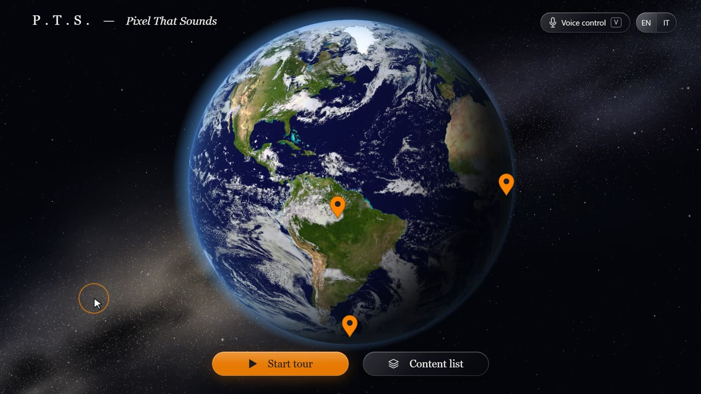
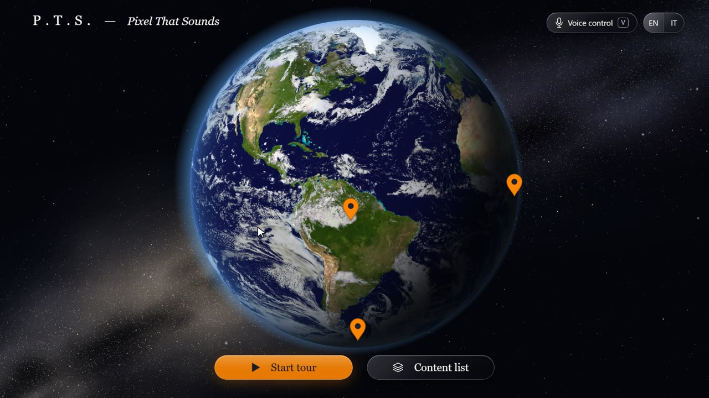
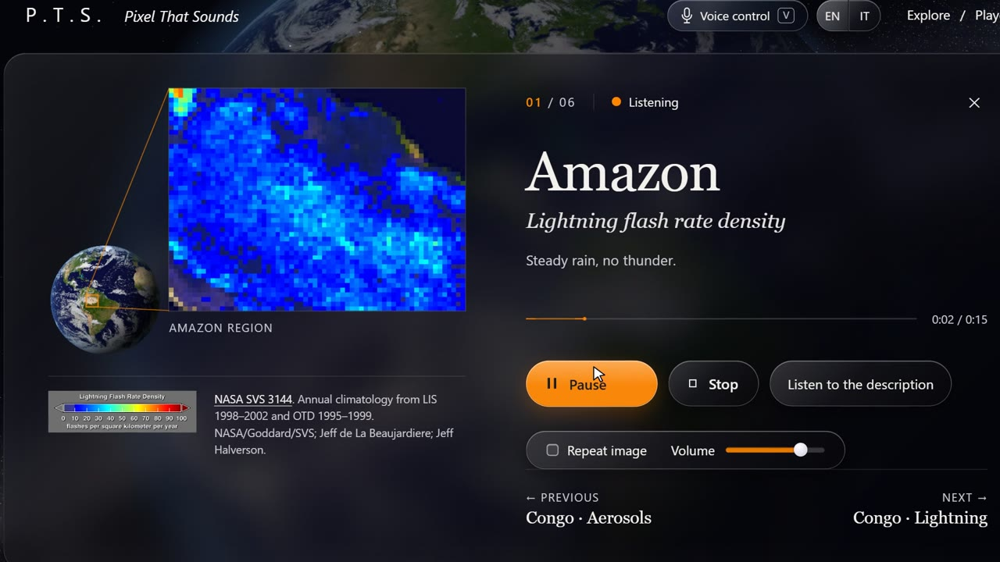
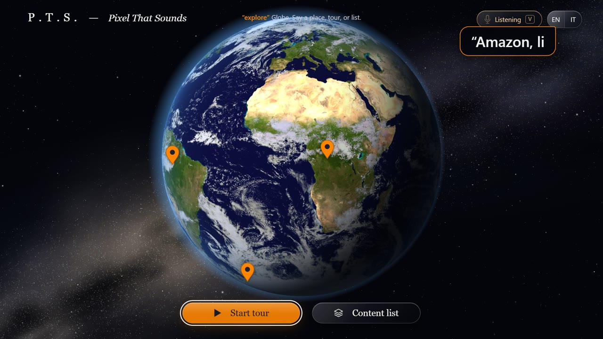

<div align="center">

# P.T.S. — Pixel That Sounds

### Earth has something to tell you.

A listening guide to NASA Earth imagery: choose a place on a turning globe and **hear** what the colours of the image mean.
Built so that blind and low-vision people can use all of it, by keyboard, screen reader or voice.

**[▶ Open the live demo](https://pixelthatsounds.github.io/)** &nbsp;·&nbsp; **[🎬 Watch the 29-second film](https://pixelthatsounds.github.io/film/pts-promo-29s.mp4)** &nbsp;·&nbsp; NASA Space Apps 2026

[](https://pixelthatsounds.github.io/film/pts-promo-29s.mp4)

<sub>Click the picture to play the film. The file is also in the repository: <a href="film/pts-promo-29s.mp4">film/pts-promo-29s.mp4</a>.</sub>

</div>

---

## How a pixel becomes a sound

| 1 · Pick a NASA image | 2 · One base sound per category | 3 · Intensity shapes the sound |
|---|---|---|
| Three regions (Amazon, Congo, Antarctica) and three kinds of NASA visualization: lightning, sea-surface temperature colours, aerosols. | Each category has its own recorded base sound: rain and thunder for lightning, a singing voice for ocean temperature, coughs for smoke. | The image is scanned left to right. Stronger pixels raise the sound: heavier rain and more thunder, more coughs, a different voice. |

Nothing is generated at random: every track is rendered from the pixels of the image by rules you can read and re-run in [`sonification/`](sonification/README.md).

## Listen

| Region | Lightning | Ocean temperature colours | Aerosols |
|---|---|---|---|
| **Amazon** | [Steady rain, no thunder](assets/audio/amazon-rain.mp3) | [Atlantic near the river mouth, soprano](assets/audio/amazon-ocean-soprano.mp3) | Image only |
| **Congo** | [Heavier rain and nine thunder groups](assets/audio/congo-storm.mp3) | Image only | [Thirteen groups of coughs](assets/audio/congo-air-pollution-cough-dense.mp3) |
| **Antarctica** | [Illustrative wind](assets/audio/antarctica-wind.mp3) | [Southern Ocean, low male voice](assets/audio/antarctica-ocean-deep-male.mp3) | Image only |

Compare the Amazon and the Congo by ear: rain alone over the Amazon, heavier rain with thunder over the Congo.

## The site

| Globe | Player | Voice control |
|---|---|---|
|  |  |  |
| Three pins, a guided tour and a content list of all nine views. | The NASA image, its legend and source, and the sound made from it. | Press **V** and talk: “Explore”, “Amazon, lightning”, “Listen”. |

## Made to be used without sight

- **Voice control** in English and Italian: every button has a spoken command, from passing the entrance to pausing a sound.
- **Keyboard and screen reader**: native controls with names, a visible focus ring, announced state changes. A braille display works through the screen reader.
- **Descriptions on request**: each image has a spoken description, its legend and its source.
- **The globe is optional**: the content list and voice control reach every view without it.

What has and has not been tested with assistive technology is recorded honestly in [specs/submission.md](specs/submission.md).

## Run it locally

Needs [Node.js](https://nodejs.org); there is nothing to install.

```sh
node site/serve.mjs
```

Open <http://localhost:4173/> in Chrome or Edge. Voice commands and screen-reader steps are in [site/README.md](site/README.md).

## What is in the repository

| Folder | Contents |
|---|---|
| [`site/`](site/README.md) | The demo site: plain HTML, CSS and JavaScript modules, no build step, no dependencies. |
| [`assets/`](assets/images/README.md) | The nine NASA image references with sources, and the [six approved tracks](assets/audio/README.md) with credits and checksums. |
| [`sonification/`](sonification/README.md) | The image-to-sound renderer and its measurements. |
| [`film/`](film/README.md) | The 29-second film and the script that renders it from the real site. |
| [`specs/`](specs/README.md) | Product agreement, submission checklist, storyboard and tickets. |

## Limits we state openly

- The sounds are designed metaphors of image colours. They are not measurements of rainfall, storm severity or air quality.
- The Antarctic lightning image has no usable overlay, so its wind is an illustrative cue and is announced as such.
- The source images cover different periods. No change over time is claimed.
- Tests with a screen reader, a braille display and listeners are still to be done.

## Credits

NASA Scientific Visualization Studio imagery (sources and periods in [assets/images/README.md](assets/images/README.md)). Recorded samples and their licences are in [assets/audio/README.md](assets/audio/README.md). The film's narration uses ElevenLabs voices; its typing and click sounds were supplied by the team.

The audio, the analysis code, the site, the film and this documentation were prepared with AI assistance.
