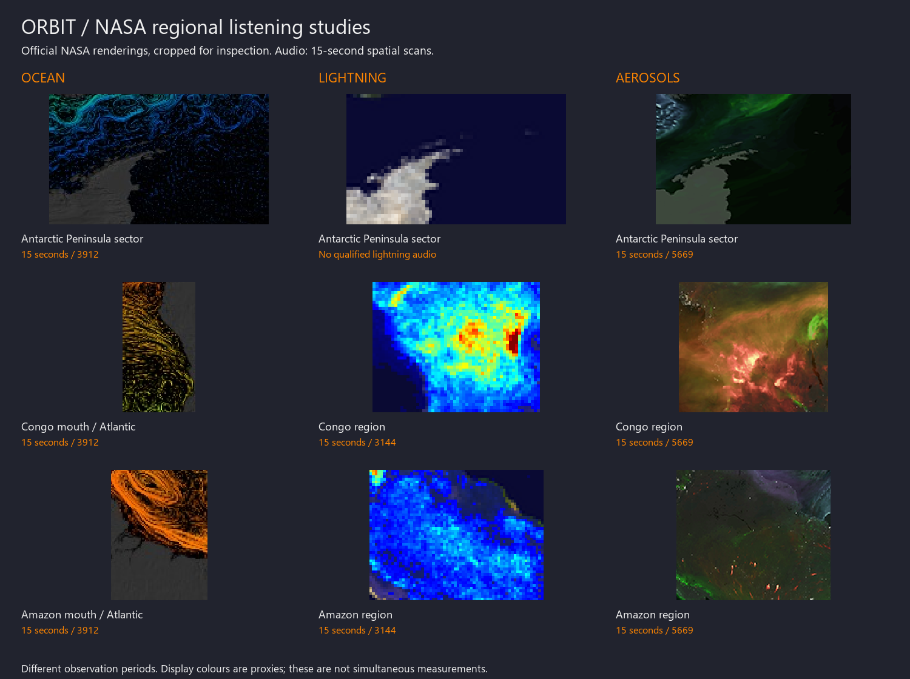

# Nine NASA regional reference images

These nine regional views come from three official global NASA visualizations. The preview crops were enlarged with nearest-neighbour sampling; their scientific colours were not edited or generated.

| Region | Ocean | Lightning | Aerosols |
|---|---|---|---|
| Antarctic Peninsula sector | [Image](antarctica-ocean.png) | [Image](antarctica-lightning.png) | [Image](antarctica-aerosols.png) |
| Congo region | [Atlantic near river mouth](congo-ocean.png) | [Image](congo-lightning.png) | [Image](congo-aerosols.png) |
| Amazon region | [Atlantic near river mouth](amazon-ocean.png) | [Image](amazon-lightning.png) | [Image](amazon-aerosols.png) |

## Originals, legends and provenance

The `originals/` folder preserves the three original NASA downloads unchanged. The `legends/` folder preserves their source legends. [sources.json](sources.json) records SHA-256 hashes, credits, observation periods, approximate geographic rectangles and exact source-pixel rectangles.

- **Ocean:** [NASA SVS 3912](https://svs.gsfc.nasa.gov/3912/), [original](originals/ocean.jpg), [legend](legends/ocean.png). ECCO2 surface-current streamlines coloured by sea-surface temperature; visualization covers March 2007 to March 2008, exact preview instant unqualified. Credit: NASA/Goddard/SVS; Greg Shirah; ECCO2 MIT/JPL.
- **Lightning:** [NASA SVS 3144](https://svs.gsfc.nasa.gov/3144/), [original](originals/lightning.png), [legend](legends/lightning.png). Annual climatology from LIS 1998–2002 and OTD 1995–1999. Credit: NASA/Goddard/SVS; Jeff de La Beaujardiere; Jeff Halverson.
- **Aerosols:** [NASA SVS 5669](https://svs.gsfc.nasa.gov/5669/), [original](originals/aerosols.png), [legend](legends/aerosols.png). GEOS model still dated August 19, 2025, 20:00 UTC. Credit: NASA GMAO/SVS; Joseph V. Ardizzone; Helen-Nicole Kostis; scientific consulting by Lesley Ott.

Different observation periods mean these are not simultaneous or current conditions. The rectangular views are not watershed masks. The Congo and Amazon ocean panels show adjacent Atlantic water. The Antarctic lightning image remains unqualified: missing overlay cannot be distinguished from low activity, and the selected Antarctic wind sound is an artistic demonstration.

## Exact images driving the current ocean audio

The Antarctic ocean audio uses a **broader Southern Ocean band** than the Peninsula view in the nine-panel reference set. To avoid confusing the two selections, the exact native-resolution analytical inputs are stored separately:

- [Current Antarctic ocean audio crop](audio-crops/antarctica-ocean.png), original pixel rectangle `(0, 800, 2048, 960)`.
- [Current Amazon ocean audio crop](audio-crops/amazon-ocean.png), original pixel rectangle `(728, 466, 796, 558)`.

These two files are exact rectangular pixel crops without recolouring or enlargement. Their raw RGB hashes and source original are in the manifest.
