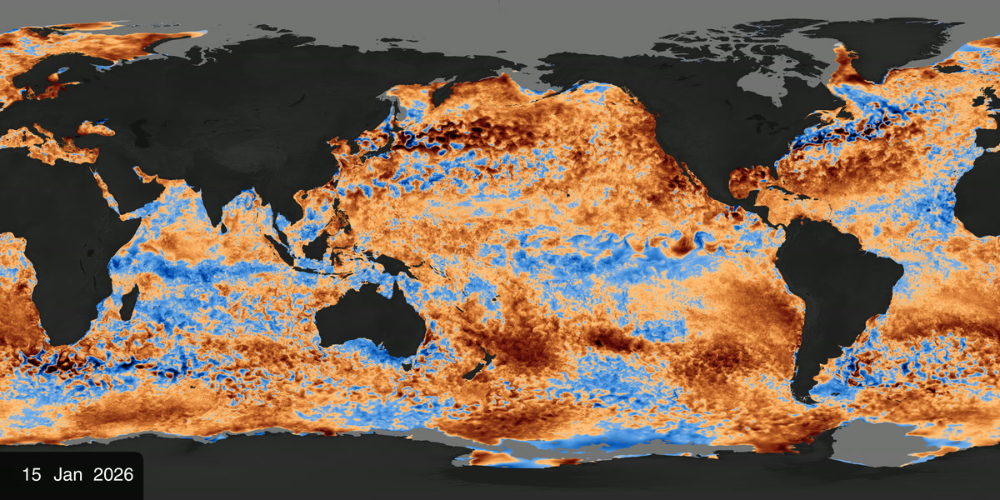
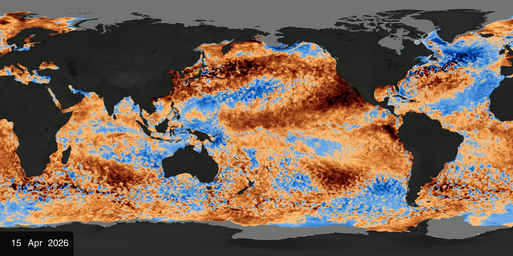
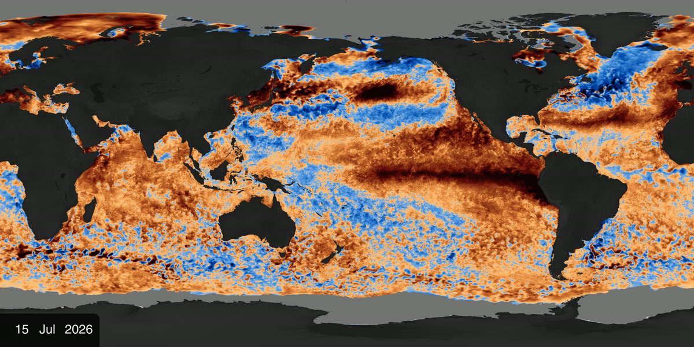
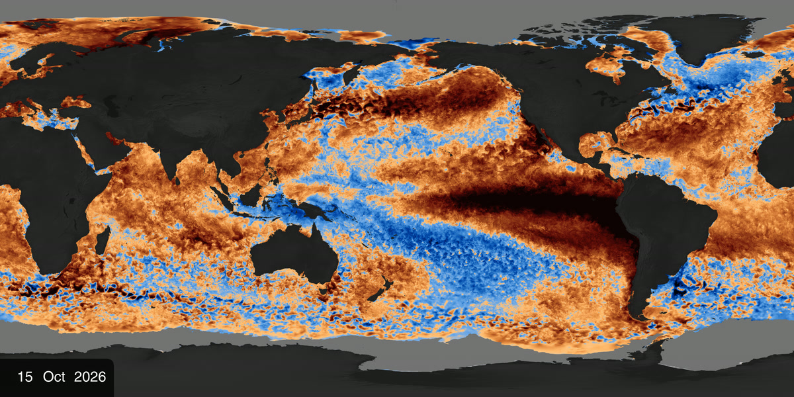
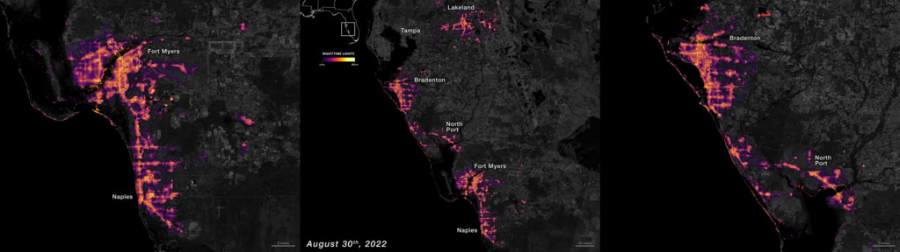
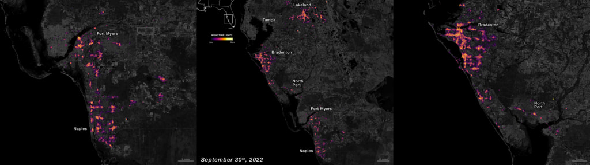

# Quattordici immagini NASA da esplorare in ORBIT

## Oceani · Quattro osservazioni, sei coppie

Dov’è cambiata l’anomalia della temperatura superficiale del mare? Le quattro mappe globali MUR del JPL hanno il Pacifico al centro, la stessa proiezione e la stessa legenda da −4 a +4 °C. Il blu segnala un’anomalia negativa, il rosso positiva. I quattro mesi permettono di seguire la stessa zona nell’arco dell’anno. Credito: NASA's Scientific Visualization Studio. Visualizzazione di Kel Elkins. [Scheda e legenda NASA](https://svs.gsfc.nasa.gov/5176/)

| Osservazione | Osservazione |
|---|---|
| **15 gennaio 2026**  [Apri anteprima](sst_mur_anomaly_pacific_20260115.jpg) · [Originale NASA](https://svs.gsfc.nasa.gov/vis/a000000/a005100/a005176/frames/4096x2048_2x1_30p/sst_mur_anomaly_pacific/sst_mur_anomaly_pacific_20260115.exr) | **15 aprile 2026**  [Apri anteprima](sst_mur_anomaly_pacific_20260415.jpg) · [Originale NASA](https://svs.gsfc.nasa.gov/vis/a000000/a005100/a005176/frames/4096x2048_2x1_30p/sst_mur_anomaly_pacific/sst_mur_anomaly_pacific_20260415.exr) |
| **15 luglio 2026**  [Apri anteprima](sst_mur_anomaly_pacific_20260715.jpg) · [Originale NASA](https://svs.gsfc.nasa.gov/vis/a000000/a005100/a005176/frames/4096x2048_2x1_30p/sst_mur_anomaly_pacific/sst_mur_anomaly_pacific_20260715.exr) | **15 ottobre 2026**  [Apri anteprima](sst_mur_anomaly_pacific_20261015.jpg) · [Originale NASA](https://svs.gsfc.nasa.gov/vis/a000000/a005100/a005176/frames/4096x2048_2x1_30p/sst_mur_anomaly_pacific/sst_mur_anomaly_pacific_20261015.exr) |

Per il primo confronto proponiamo gennaio e ottobre nel Pacifico equatoriale, dove la fascia a ovest del Sud America passa dal blu a tonalità calde. Per la tendina A/B usare lo stesso ritaglio e la stessa scala. Escludere terraferma, scritte e dati mancanti dal suono. Prima di descrivere un numero in °C verificare il valore sui dati scientifici. Le anteprime JPEG servono all’ispezione visiva.

## Florida · Prima e dopo l’uragano Ian

Dove si vedono meno luci dopo l’uragano? Le immagini NASA Black Marble mostrano la stessa parte della Florida in agosto e settembre con tre inquadrature affiancate. Per la demo proponiamo di isolare il pannello sinistro, che comprende Fort Myers e Naples, identico per posizione e dimensioni in A e B. Per l’ascolto occorre separare le luci colorate dal fondale, dai nomi delle città e dalla scala grafica. Credito: NASA's Scientific Visualization Studio. Visualizzazione di Michala Garrison su dati VIIRS di Suomi NPP. [Scheda NASA](https://svs.gsfc.nasa.gov/5058/)

| Osservazione | Osservazione |
|---|---|
| **30 agosto 2022**  [Apri anteprima](black_marble_aug2160_print.jpg) · [Originale NASA](https://svs.gsfc.nasa.gov/vis/a000000/a005000/a005058/black_marble_aug2160.png) | **30 settembre 2022**  [Apri anteprima](black_marble_sep2160_print.jpg) · [Originale NASA](https://svs.gsfc.nasa.gov/vis/a000000/a005000/a005058/black_marble_sep2160.png) |

## Verifica nel lettore

Le quattro date oceaniche consentono sei coppie distinte. Le due date della Florida aggiungono una coppia. Invertire A e B cambia l’ordine di ascolto e conta come la stessa coppia. Per abilitare ciascun confronto verificare allineamento, maschera e regole sonore condivise. Le due riprese del Fuji aggiungono un ottavo confronto candidato. Per tutte le coppie, verificare anche che la differenza risulti udibile usando lo stesso intervallo della frase.

Le anteprime oceaniche sono riduzioni a 1200 × 600 dei quattro originali OpenEXR NASA con lo stesso ridimensionamento Lanczos. Le due anteprime della Florida sono JPEG pubblicati dalla NASA.

## Paesaggi e Monte Fuji

| Scena locale | Cosa esplorare | Credito e scheda ufficiale |
|---|---|---|
| [Bahamas](bahamas.jpg) | Correnti e maree disegnano solchi nei banchi di sabbia. | [Serge Andrefouet, University of South Florida](https://science.nasa.gov/earth/earth-observatory/ocean-sand-bahamas-2780/) |
| [Namib](namib.jpg) | I cordoni di dune terminano lungo il corso del Kuiseb. | [Joshua Stevens, NASA Earth Observatory, dati Landsat USGS](https://science.nasa.gov/earth/earth-observatory/where-the-dunes-end-146064/) |
| [Malaspina](malaspina.jpg) | Il ghiacciaio si allarga a ventaglio ai piedi delle montagne, in una vista prospettica. | [SRTM Team, NASA/JPL/NIMA](https://science.nasa.gov/earth/earth-observatory/malaspina-glacier-alaska-2-3421/) |
| [Richat](richat.jpg) | Anelli di roccia concentrici emergono tra i campi di dune. | [Equipaggio Expedition 63, ISS Crew Earth Observations Facility e NASA/JSC](https://science.nasa.gov/earth/earth-observatory/the-eye-of-sahara-150060/) |
| [Sarychev](sarychev.jpg) | Un pennacchio di cenere si estende dal vulcano sopra le Curili. | [Jeff Schmaltz, NASA MODIS Rapid Response Team](https://science.nasa.gov/earth/earth-observatory/ash-eruptions-from-sarychev-peak-kuril-islands-38957/) |
| [Fuji con più neve](fuji-2013.jpg) | La copertura nevosa chiara disegna i fianchi del cono. | [Joshua Stevens, NASA Earth Observatory, dati Landsat USGS](https://science.nasa.gov/earth/earth-observatory/mount-fujis-missing-snow-147780/) |
| [Fuji con meno neve](fuji-2021.jpg) | Sul medesimo cono si vede una copertura nevosa meno estesa. | [Joshua Stevens, NASA Earth Observatory, dati Landsat USGS](https://science.nasa.gov/earth/earth-observatory/mount-fujis-missing-snow-147780/) |
| [Delta della Lena](lena.jpg) | I canali del fiume si ramificano verso il mare artico, in falsi colori. | [Landsat 7, NASA/USGS](https://science.nasa.gov/earth/earth-observatory/lena-river-delta-2704/) |

La [selezione delle 14 scene](selezione.json) fissa ordine della playlist, impronta dei file, spiegazione breve, gruppi confrontabili e associazioni caldo/freddo. La qualifica per il lettore richiede anche maschere, voce, diritti, mappatura sonora e prova offline.

Per gli otto file Earth Observatory il registro include anche il collegamento diretto alla specifica variante scaricata. L’impronta SHA-256 di ciascun JPEG locale coincide con quella del file pubblicato dal server NASA.
