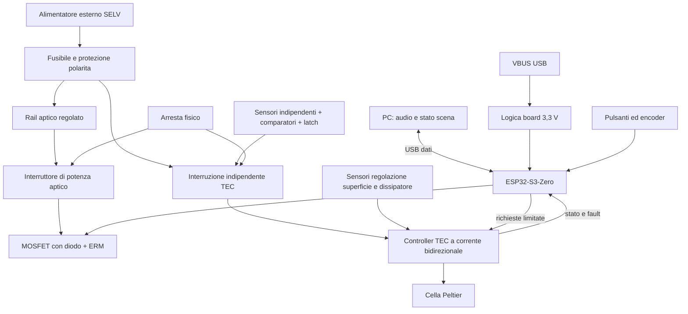

# Specifica del controller immersivo

Progetto preliminare. [Prodotto](prodotto.md) · [Modello e file](../controller/README.md).

## 1. Risultato e requisiti

L'hardware estende un software già completo. Per la prima consegna sono richiesti un progetto tecnicamente credibile, lo schema funzionale, le interfacce, la distinta preliminare, le regole di dimensionamento e le verifiche future. CAD esecutivo, render, firmware e montaggio seguiranno eventuali ticket approvati. Non si presume disponibile una vecchia scheda o una batteria.

| ID | Priorità | Requisito e motivo | Criterio di completamento futuro |
|---|---|---|---|
| HW01 | P0 | Board identificata prima del cablaggio | Foto/sigla/revisione fisica confrontate con schema, pin e flash/PSRAM; tabella pin approvata per quel pezzo |
| HW02 | P0 | Comandi distinguibili senza vista | Mappa tattile, forme e distanze documentate; prova su mockup; nessuna funzione essenziale in combinazioni Braille |
| HW03 | P0 | Attuatori separati dalla logica | Schema con rail, ritorni, driver, protezioni e assorbimenti; nessun attuatore alimentato da GPIO |
| HW04 | P0 | Arresto locale indipendente dal browser | Circuito di disabilitazione attuatori, default OFF, watchdog e percorso di fault documentati; test fisico futuro distinto dal simulatore |
| HW05 | P0 | Modulo termico completo e volontario | Sensori superficie/dissipatore, cutoff indipendente, consenso locale temporizzato, controllo corrente e recupero previsti |
| HW06 | P0 | Nessun setpoint presentato come sicuro senza prova | Profilo di contatto non abilitabile finché limiti, inerzia, condensa e guasti non hanno misure e revisione dedicata |
| HW07 | P0 | Alimentazione termica distinta dalla USB PC | Nessun collegamento positivo fra rail esterno e VBUS; verifica anti-ritorno e livelli segnali |
| HW08 | P1 | ERM con pattern pochi e coerenti | Distinzione azione accettata/limite/fault; stop locale sempre possibile; percezione da verificare |
| HW09 | P0 | Meccanica modulare realizzabile | Parametri legati agli ingombri reali, accesso USB/stop, separazione termica, montaggio e viste definite |
| HW10 | P0 | BOM e costi trasparenti | Quantità, alternative, costi stimati o verificati distinti; acquisti non eseguiti |
| HW11 | P0 | Firmware nativo ESP-IDF | Architettura task, parser limitato, ingressi, watchdog e fault specificati; nessuna dipendenza Arduino |
| HW12 | P1 | Mostrare progetto e limiti nel video | Render e simulazioni marcati; nessun claim di vibrazione o contatto termico misurati |

## 2. Controlli e disposizione

Il riferimento corrente è la [presa a due mani](../images/controller/presa.png). A sinistra si trovano precedente, ascolta/pausa e successivo. Tre righe identificano Descrivi, il quadrato Arresta e il punto in rilievo la richiesta termica. La manopola regola il volume. La forma è stata accolta come mockup. Disposizione, distanze e ingombri sono da provare.

Sei pulsanti: precedente, successiva, ascolta/pausa, descrivi, arresta, richiesta termica. Encoder volume a scatti, senza pressione necessaria. Proposte per mockup: cappucci principali 18–24 mm, spazio libero fra cappucci almeno 12 mm, Arresta circa 30 mm e distante dal termico. Sono quote ergonomiche iniziali da provare, non misure di componenti già posseduti. Pulsante termico fuori dalla zona percorsa per cercare la manopola. Nessun obbligo di appoggiare la mano su una superficie attiva per raggiungere i comandi.

Il click meccanico conferma una pressione; la vibrazione breve conferma **l'accettazione da parte del PC**. Niente vibrazione di successo immediata prima dell'ACK. Pattern proposti: accettato 1×80 ms; limite raccolta 2×60 ms separati da 100 ms; errore 1×250 ms, soltanto se lo stadio aptico è sano. Arresta interrompe qualunque pattern. Una richiesta ripetuta non prolunga indefinitamente la vibrazione: massimo 500 ms per comando e una sola sequenza alla volta, da verificare percettivamente. Niente codifica scientifica aptica nella prima versione.

Braille eventuale solo dopo verifica delle iscrizioni e della geometria da persone competenti; forme e posizione devono bastare senza Braille. Nessun OLED nel perimetro iniziale.

## 3. Architettura elettrica e alimentazioni

USB alimenta solo la logica della board. Il rail attuatori usa un alimentatore esterno isolato da rete, con uscita SELV e corrente limitata; proposta di studio 12 V, con conversione per ERM 3 V e ventola secondo componenti. Nessun ramo positivo dell'alimentazione esterna entra nel pad 5V/USB della Zero. Ritorni di potenza e segnali separati fino al punto stella; collegamento delle masse o isolamento della comunicazione da definire sul controller effettivo. Verificare che RX/TX e GPIO non retroalimentino un modulo spento: transceiver con stato alta impedenza e protezione appropriati.

Il regolatore a bordo non è una sorgente per Peltier, ERM o ventola. Le connessioni di potenza non attraversano piste sottili di millefori o ponticelli Dupont: morsetti polarizzati, sezione fili e fusibili scelti sulla corrente reale. Millefori dedicata alla logica e ai moduli fissati; potenza termica su modulo proprio. Fusibile dimensionato per proteggere conduttori/connettori, non sul solo massimo commerciale del driver.

**ERM principale:** motore a massa eccentrica 3 V, candidato 60–100 mA di marcia da verificare; MOSFET logic-level con resistenza gate, pull-down, diodo di ricircolo dimensionato sul motore, disaccoppiamento locale e rail regolato. Il valore Rds(on) deve essere specificato a una tensione gate compatibile con 3,3 V. Corrente di spunto/blocco da misurare. Alternativa LRA + [DRV2605L](https://www.ti.com/product/DRV2605L): controllo più strutturato e vibrazione da qualificare, ma costo e calibrazione maggiori. Non scegliere un LRA come se fosse un ERM a due fili pilotabile allo stesso modo.

**Termico principale:** controller TEC dedicato con regolazione bidirezionale di corrente, limiti memorizzati, ingressi temperatura e interfaccia locale. Riferimento concreto di fattibilità: [Meerstetter TEC-1091](https://www.meerstetter.ch/products/tec-controllers/tec-1091), con sensori oggetto/dissipatore e controllo dedicato. Collegamento interno proposto RS485 attraverso transceiver 3,3 V da qualificare; pin, terminazione e protocollo del modulo si fissano dal manuale della configurazione acquistabile. Non è una scelta d'acquisto approvata. Alternativa economica: ponte H con misura/limitazione corrente, filtraggio, regolatore e protezioni progettati separatamente; aumenta molto il lavoro e non è il percorso consigliato per una persona durante l'evento. Un [DRV8833](https://www.ti.com/product/DRV8833) è un driver motore con regolazione di corrente, non un sistema completo di controllo termico né una sostituzione automatica a 12 V.

## 4. Pin e verifica della board

La documentazione [Waveshare](https://docs.waveshare.com/ESP32-S3-Zero) descrive anche varianti N8R8; la denominazione commerciale da sola non identifica il pezzo. Il [PDF dello schema FH4R2](https://files.waveshare.com/wiki/ESP32-S3-Zero/ESP32-S3-Zero-Sch.pdf) riporta pad IO1–13 e pad aggiuntivi 14–18. È stato controllato il contenuto documentale, non una scheda fisica. Prima del montaggio occorre confrontare revisione e accessibilità reale dei pad.

Allocazione preliminare compatibile con quei segnali, **non pinout esecutivo autorizzato**:

| GPIO | Uso proposto | Stato / vincolo |
|---|---|---|
| 1, 2 | Monitoraggio analogico temperatura superficie e dissipatore, tramite sensori separati | ADC1 secondo documentazione Espressif; non sostituiscono sensori del cutoff |
| 4, 5 | Precedente, Successiva | Ingressi a pull-up, contatto verso massa |
| 6, 7 | Ascolta/Pausa, Descrivi | Idem; debounce locale |
| 8 | Lettura Arresta | Contatto distinto dal circuito hardware di disabilitazione |
| 9 | Richiesta termica | Consenso locale, un gesto per un ciclo |
| 10, 11 | Encoder A/B | Delta a scatti, validazione quadratura |
| 12 | Comando ERM | Solo gate/stadio logico, default basso |
| 13 | Richiesta enable attuatori | AND con stop/cutoff/watchdog; pull-down esterno |
| 14 | Fault hardware latched | Livello compatibile 3,3 V; pad da verificare fisicamente |
| 15, 16 | UART TX/RX verso interfaccia del controller TEC | Adattamento elettrico necessario; non collegare direttamente a RS485/RS232 |
| 17 | Direzione transceiver se necessaria | Riserva condizionata al bus del controller scelto |
| 18 | Riserva per stato ventola/interlock | Non essenziale al percorso base |

GPIO19/20 riservati alla USB; 21 già impiegato dal LED; 0/3/45/46 esclusi dagli ingressi di progetto per vincoli di boot; niente 26–37 come GPIO generici. Queste restrizioni derivano da [GPIO Espressif](https://docs.espressif.com/projects/esp-idf/en/v5.5.1/esp32s3/api-reference/peripherals/gpio.html) e dalla documentazione board. UART0 43/44 lasciata libera per diagnosi quando disponibile. Verifica elettrica finale: continuità, assenza corti, boot con tutti i comandi premuti, reset, enumerazione USB, assorbimenti, nessun back-power.

USB CDC tramite componente TinyUSB di ESP-IDF, documentato nella [guida v5.5.1](https://docs.espressif.com/projects/esp-idf/en/v5.5.1/esp32s3/api-reference/peripherals/usb_device.html). Versione 5.5.1 usata qui come riferimento leggibile, non dichiarata ultima release; versione e dipendenze saranno fissate e compilate nel lavoro futuro. Niente driver USB-UART immaginato sulla Zero, niente HID come unico canale bidirezionale.

## 5. Sistema termico e bilancio preliminare

Stack meccanico previsto: piastrina smussata isolata elettricamente → interfaccia termica → TEC → interfaccia → dissipatore con eventuale ventola. Isolare la piastrina rispetto al telaio e rendere inaccessibili superfici posteriori e cablaggi. Sensori di regolazione in contatto termico documentato con piastrina e dissipatore; un sensore di protezione indipendente e relativo comparatore non devono condividere l'unico possibile guasto del circuito principale.

Energia: in raffreddamento `Q_hot=Q_cold+P_elettrica_TEC`; la ventola e le perdite driver si aggiungono al bilancio di alimentazione. Non dimensionare il dissipatore con la sola potenza sottratta alla piastrina. Le curve del TEC alla differenza di temperatura effettiva determinano la corrente; `Qmax` a condizioni commerciali non è la capacità disponibile in uso. La preferenza per corrente regolata con ripple controllato è coerente con il [compendio del produttore Meerstetter](https://www.meerstetter.ch/customer-center/compendium/71-peltier-element-efficiency); non si riusa il rendimento di un loro esempio come prestazione ORBIT.

**Esempio di dimensionamento, non scelta sicura né misura:** ipotizzare `Q_cold=3 W`, `P_TEC=8 W`, quindi `Q_hot=11 W`. Se il progetto del vano ammettesse un aumento del dissipatore di 15 K, la resistenza totale dissipatore/aria richiesta sarebbe ≤15/11=1,36 K/W, da ridurre tenendo conto delle interfacce. Il valore 15 K non è un limite di contatto e non vale come approvazione termica. Se driver η=0,85, ventola=1,5 W e ramo aptico=0,5 W, alimentazione esterna richiesta ≈8/0,85+1,5+0,5=11,41 W; con margine progettuale 30% ≈14,84 W. Una classe 12 V/2 A può essere studiata, ma non selezionata senza curve, spunti, compatibilità e prove.

Stima distinta della logica USB, da misurare: riserva di progetto 5 V×0,25 A=1,25 W, Wi-Fi/BLE disattivati. Non è una certificazione di conformità al budget USB; descrittori, spunto e assorbimento vanno verificati. Il termico resta privo di energia con il solo cavo PC.

La progettazione deve riempire prima dell'abilitazione: `surfaceMin/Max`, `sinkMax`, `currentMax`, `slewMax`, `contactDurationMax`, `recoveryBand`, tempo minimo stabile, margine rispetto al punto di rugiada, tolleranze sensori e soglie indipendenti. **I limiti per il contatto richiedono validazione.** Il profilo di fabbrica di ORBIT sarà `thermalEnabled=false`; impostazioni mancanti non vengono riempite con numeri di esempio.

Condensa: misurare ambiente/umidità o adottare un limite conservativo documentato; impedire raffreddamento che scenda nel dominio di rischio definito. Un sensore che legge la temperatura non prova assenza di condensa altrove. Considerare inerzia dopo stop, polarità scambiata, sensore staccato ma elettricamente integro, ventola bloccata, dissipatore ostruito, driver corto e brownout MCU.

## 6. Stati termici e arresto

| Stato | Potenza e accesso | Passaggio consentito |
|---|---|---|
| DISABILITATO | TEC OFF, nessuna richiesta accettata | Solo profilo fisico verificato e significato scena valido permettono NEUTRO |
| NEUTRO | Nessun pilotaggio; misura conferma banda di recupero | Pressione volontaria termico crea consenso temporaneo |
| PREPARAZIONE | Rampa controllata entro limiti, area non dichiarata pronta al contatto | Pronto solo dopo stabilità verificata; timeout o guasto → FAULT/RECUPERO |
| PRONTO | Stato mantenuto per finestra locale finita | Nuova pressione dedicata avvia ATTIVO, oppure scadenza → RECUPERO |
| ATTIVO | Esperienza temporizzata e limitata localmente | Stop, fine timer, cambio scena, pausa o link perso → RECUPERO |
| RECUPERO | Comando TEC OFF; ventola eventualmente continua autonomamente | NEUTRO soltanto dopo misura stabile; nessun riavvio automatico |
| FAULT | Latch hardware interrompe TEC e aptica secondo guasto; ventola di raffreddamento separata se necessaria | Reset locale dopo rimozione causa e condizioni misurate; niente reset remoto automatico |

Le due pressioni termiche hanno funzioni esplicite: «prepara» e, dopo avviso di pronto, «attiva esperienza». Nessuna pressione prolungata o combinazione nascosta. Per il prototipo fisico iniziale la superficie resta protetta dal contatto durante prove strumentali. Anche a TEC OFF può essere calda/fredda: non annunciare «neutro» senza lettura valida.

Arresta usa almeno due contatti/funzioni: disabilitazione elettrica diretta tramite catena di enable e lettura MCU. La disabilitazione termica deve agire anche su un interruttore di potenza indipendente dal driver (guasto driver bloccato acceso). Comparatore a finestra e latch, con soglie da dimensionare, spengono senza firmware. Un semplice termofusibile caldo non copre il freddo. Watchdog esterno toglie enable se la MCU non aggiorna il segnale; all'accensione/reset enable basso. La ventola può richiedere alimentazione separata mantenuta per recupero: Arresta ferma gli stimoli, non necessariamente la ventilazione protettiva.

## 7. BOM preliminare e costi

Nessun ordine eseguito. Fasce in EUR sotto: **stime di pianificazione del 31/10/2026**, non prezzi verificati né preventivi, IVA/spedizione e attrezzi esclusi. Nessun vecchio tetto 50/100 USD applicato.

| Voce | Qtà | Specifica / alternativa | Stima costo |
|---|---:|---|---:|
| ESP32-S3-Zero posseduta | 1 | Revisione da identificare | 0 € incrementale, disponibilità riferita |
| Pulsanti e cappucci tattili | 6 | Arresta con percorso hardware separato | 12–25 € |
| Encoder e manopola | 1 | Scatti riconoscibili, nessun push essenziale | 3–8 € |
| ERM + driver discreto | 1 gruppo | LRA+DRV2605L come alternativa non inclusa | 4–10 € |
| Millefori, supporti, fissaggi | 1 gruppo | Moduli rimovibili | 6–15 € |
| Cablaggi, connettori, USB dati | 1 gruppo | Polarizzazione e scarico trazione | 5–12 € |
| Contenitore e piedini | 1 gruppo | Stampa/realizzazione da quotare | 10–25 € |
| Protezioni e regolatore aptico | 1 gruppo | Rail esterno e cutoff | 6–15 € |
| **Sottototale comandi/aptica** | | Esclude alimentatore esterno e termico | **46–110 €** |
| Cella TEC di piccola potenza | 1 | Da scegliere su curve, non TEC generica ad alto assorbimento | 8–25 € |
| Dissipatore e ventola | 1 gruppo | Da bilancio e rumore ammesso | 15–40 € |
| Sensori, comparatori, latch, switch e transceiver | 1 gruppo | Indipendenza reale da verificare | 25–70 € |
| Alimentatore esterno | 1 | Tensione/corrente dopo dimensionamento | 20–40 € |
| Piastrina, isolamento e interfacce | 1 gruppo | Bordo smussato, sensori fissati | 10–25 € |
| **Termico escluso controller** | | | **78–200 €** |
| Controller TEC dedicato di riferimento | 1 | TEC-1091, configurazione da selezionare | **318 CHF** base, imposte escluse, prezzo pagina consultata |

Totale indicativo della soluzione completa: **124–310 € più 318 CHF**, senza convertire valute né presumere tasse/spedizione/configurazioni incluse. Il prezzo di riferimento non autorizza l'acquisto e va aggiornato. Il prodotto segnala opzioni software a pagamento: prima di selezionarlo verificare che le sole funzioni necessarie funzionino senza licenze aggiuntive. Non serve comprarlo per consegnare il progetto. Un'alternativa meno costosa richiede una nuova verifica tecnica ed economica, non un ponte H scelto soltanto sul prezzo.

## 8. Meccanica e firmware da sviluppare successivamente

Modello parametrico futuro: `boardEnvelope`, `connectorClearance`, `buttonPitch`, `knobEnvelope`, `stopClearance`, `plateEnvelope`, `heatsinkEnvelope`, `airDuct`, `wallThickness`, `mountHolePattern`, `wireBendRadius`, tolleranze di processo. Larghezza ≥ingombro fila comandi+spazi+pareti; altezza ≥massimo stack interno+cablaggio+gioco. Nessuna dimensione esterna definitiva prima dei componenti. Base comandi e modulo termico smontabili separatamente; dissipatore verso retro/lato, flusso aria lontano da mano e microfono; centro di massa entro l'appoggio; viti e manutenzione accessibili.

Viste future necessarie: pianta con accessi, sezione dello stack termico, supporto millefori con moduli/cablaggi, contenitore chiuso, esploso con ordine di montaggio. Render con etichetta «PROGETTO — NON COSTRUITO». Il CAD deve prevedere un mockup inerte per prove tattili prima dell'elettronica; non presentare quel mockup come dispositivo termico funzionante.

Firmware previsto: task ingressi con debounce; task protocollo con parser bounded; task stato/sicurezza prioritario e non bloccato dalla seriale; task driver aptico; adapter del controller termico; watchdog. Intervallo di supervisione software proposto 10 ms, sensori 20 Hz, heartbeat secondo contratto. Sono target da verificare e non limiti di sicurezza certificati. Nessun task DSP o streaming audio. Timer monotono locale per scadenze; nessuna dipendenza da ora internet.

## 9. Sequenza di verifica fisica futura

1. Mockup inerte: orientamento, ricerca Arresta, comandi, stabilità e accesso senza toccare zona termica.
2. A alimentazione scollegata: continuità, polarità, isolamenti e cablaggio confrontati con schema esecutivo.
3. Alimentazione limitata: rail e assorbimenti, reset, combinazioni di alimentazioni, assenza ritorni USB.
4. ERM: corrente/spunto, rumore, disabilitazione, pattern e guasti.
5. TEC su carico di prova senza contatto umano: mappa temperature con strumento indipendente, curve corrente/potenza, inerzia, condensazione, ventola e dissipatore.
6. Guasti: sensore aperto/corto/staccato, porta persa, browser fermo, MCU bloccata, driver in fault, corrente anomala, inversione; cutoff indipendente e recupero documentati.
7. Solo dopo revisione dei risultati: eventuale protocollo di contatto e prova percettiva volontaria con limiti definiti.

Schemi e simulatore soddisfano verifiche documentali/logiche; non chiudono nessuno dei passaggi fisici sopra. La fattibilità resta condizionata al dimensionamento e ai componenti selezionati, con il termico come ramo più oneroso e incerto.

## Controller per la giuria

Il simulatore riproduce il significato caldo/freddo di tutte le scene durante l’ascolto. Il tasto Termico consente di escludere la resa. La voce può spiegare la scelta. Stop, pausa e guasto la interrompono. Schemi, distinta, sorgenti della meccanica, viste dell’assemblato e dell’esploso accompagnano la demo. Le prove con sensori, corrente e superficie riguardano il futuro prototipo fisico.
